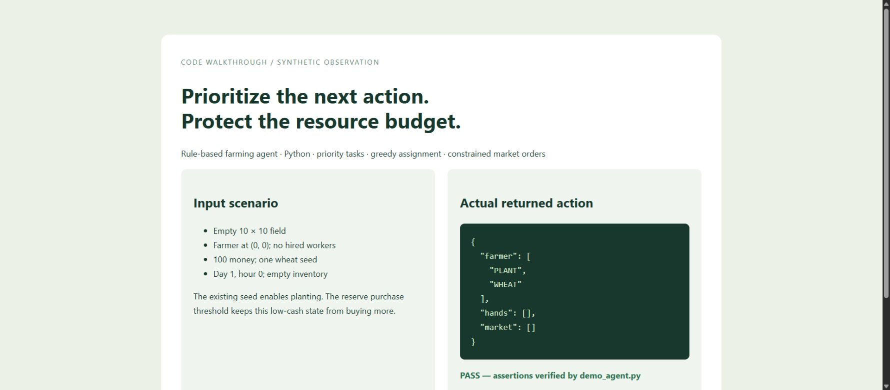

# Kaggriculture — Rule-Based Resource Allocation Agent

Explore priority-based task scheduling and constrained market decisions in a farming simulation.

**Built by Himanshu Chauhan** · [GitHub](https://github.com/himanshuc2406) · Contact: himanshuc2406@gmail.com

## Project walkthrough




## What the code implements

- Parse observations into a game state and prioritize watering, harvesting and maintenance.
- Assign idle workers to tasks by urgency and distance.
- Throttle market orders, maintain seed reserves and constrain hiring frequency.
- Run local opponent comparisons through a reproducible seed-based harness.

## Technical stack

Python · finite-state decision rules · greedy task assignment · Kaggle environments

## Run locally

```bash
python -m venv .venv
# Activate .venv for your operating system.
pip install -r requirements.txt
python demo_agent.py
```

Open **Local command-line simulation**. Never commit your `.env`, API keys, OAuth credentials or runtime databases. Blank configuration examples are provided where needed.

## Verification

The synthetic empty-field observation returned PLANT WHEAT with no market spending; assertions passed. docs/walkthrough.html renders that actual output. Historical win counts were not rerun. Use python test_local.py --opponent starter --n 10 with the compatible Kaggriculture environment for replay validation.

## Scope and limitations

This snapshot implements a wheat-focused strategy. Some planned crop/animal/expansion actions are incomplete. Local outcomes are not leaderboard claims; no competition result is asserted.

## Repository structure

- `.gitignore`
- `config.py`
- `demo_agent.py`
- `docs /`
- `main.py`
- `pathing.py`
- `README.md`
- `requirements.txt`
- `state.py`
- `test_local.py`
